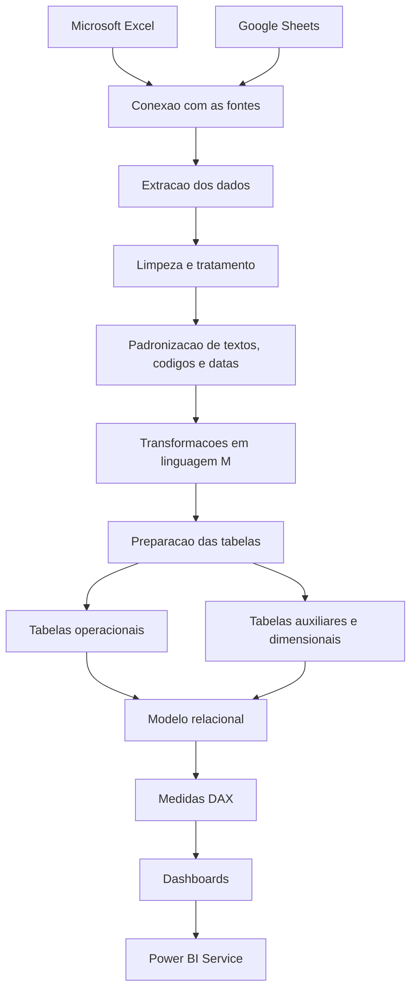
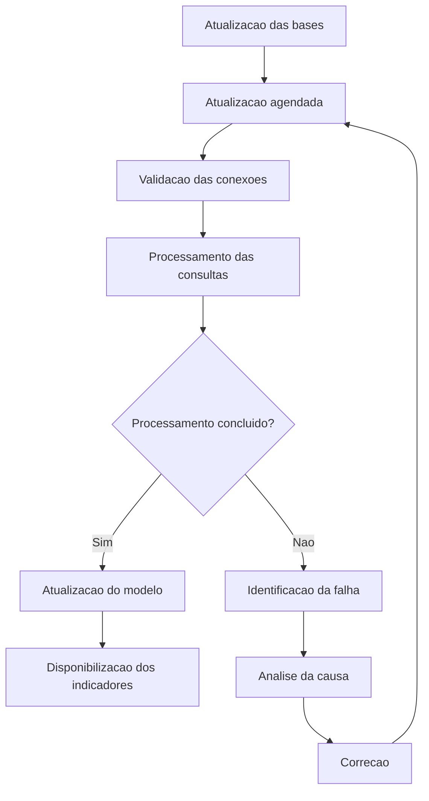

# Power Query — Extração, Transformação e Carregamento de Dados (ETL)

## 1. Contextualização

O processo de ETL do BI de Gestão de Análises e Liberações foi desenvolvido para integrar, tratar e padronizar informações provenientes de diferentes fontes de dados laboratoriais e operacionais.

As bases utilizadas apresentam diferenças estruturais, formatos de preenchimento, nomenclaturas e critérios de identificação distintos, exigindo tratamentos específicos para cada conjunto de informações.

O Power Query foi utilizado como principal ferramenta de extração e transformação, preparando os dados para a modelagem relacional e o desenvolvimento dos indicadores.

## 2. Objetivos do ETL

- Integrar diferentes fontes de dados.
- Padronizar estruturas e formatos.
- Tratar inconsistências nas informações.
- Reduzir a interferência de erros das bases nos indicadores.
- Preparar os dados para os relacionamentos.
- Adequar as informações às regras de negócio.
- Viabilizar a atualização recorrente dos dashboards.
- Facilitar a manutenção das fontes de dados.

## 3. Fontes de dados

| Fonte | Aplicação |
|---|---|
| Microsoft Excel | Armazenamento e fornecimento de informações operacionais e laboratoriais |
| Google Sheets | Disponibilização de bases para conexão e atualização |
| Tabelas auxiliares | Apoio à organização, identificação e classificação das informações |

As fontes apresentam estruturas independentes, sendo necessário realizar tratamentos individualizados antes do carregamento no modelo.

## 4. Migração das fontes de dados

Durante a evolução do projeto, foram realizadas adequações nas conexões, incluindo a migração de fontes originalmente estruturadas em arquivos Excel para o Google Planilhas.

O processo de migração teve como objetivo adequar a disponibilização das informações e viabilizar sua atualização através das novas conexões.

### Pontos considerados na migração

- Compatibilidade entre as estruturas das bases.
- Preservação dos nomes das colunas.
- Manutenção dos tipos de dados.
- Compatibilidade com as etapas de transformação existentes.
- Preservação dos relacionamentos.
- Configuração das credenciais de acesso.
- Continuidade das atualizações no Power BI Service.

A alteração das fontes exigiu atenção às dependências existentes entre as consultas, o modelo relacional e os indicadores desenvolvidos.

## 5. Limpeza e tratamento dos dados

### 5.1. Alteração dos tipos de dados

Foram realizadas adequações nos tipos de dados das colunas, considerando a natureza das informações e sua aplicação no modelo.

A definição adequada dos tipos é fundamental para:

- Realização de cálculos.
- Comparação de valores.
- Relacionamento entre tabelas.
- Ordenação das informações.
- Aplicação de filtros.
- Desenvolvimento de indicadores temporais.

### 5.2. Remoção de linhas e colunas

Foram removidas linhas e colunas desnecessárias para a finalidade analítica das consultas.

Esse tratamento contribui para reduzir informações irrelevantes e organizar as estruturas utilizadas no modelo.

### 5.3. Remoção de duplicatas

A remoção de duplicatas foi utilizada conforme a necessidade das consultas e os critérios de identificação disponíveis.

Esse tratamento deve considerar a granularidade de cada tabela, evitando a exclusão de registros legítimos que possuam atributos semelhantes.

### 5.4. Tratamento de valores nulos

Foram realizados tratamentos de valores nulos conforme as características das informações e as necessidades de cada consulta.

A interpretação de valores ausentes deve respeitar as regras de negócio, evitando que informações não preenchidas sejam classificadas indevidamente como resultados conformes, não conformes ou valores iguais a zero.

### 5.5. Tratamento de erros

Foram aplicados tratamentos para inconsistências identificadas durante o processamento das consultas.

Essas inconsistências podem estar associadas a formatos incompatíveis, alterações nas estruturas das bases ou valores que não atendam aos critérios esperados pelas etapas de transformação.

### 5.6. Substituição de valores

A substituição de valores foi utilizada para adequar informações provenientes das fontes de dados às necessidades de padronização do modelo.

Esse recurso auxilia na uniformização de nomenclaturas e classificações.

## 6. Padronização das informações

### 6.1. Padronização de textos e códigos

As bases apresentam diferentes padrões de identificação, tornando necessária a adequação dos campos textuais e dos códigos utilizados nos relacionamentos.

O tratamento desses atributos contribui para:

- Compatibilidade entre tabelas.
- Redução de divergências de identificação.
- Organização das classificações.
- Consistência dos filtros.
- Identificação de produtos e análises.

A padronização foi realizada considerando as particularidades de cada fonte, uma vez que nem todas as bases possuem um identificador único compartilhado.

### 6.2. Tratamento de datas

Os campos temporais foram tratados para garantir sua compatibilidade com os tipos de dados e relacionamentos estabelecidos no modelo.

Entre os contextos temporais utilizados estão:

- Data de produção.
- Data de coleta.
- Datas associadas aos processos analíticos.

O tratamento adequado desses campos possibilita sua integração com a dimensão calendário e a aplicação de filtros temporais.

### 6.3. Extração de informações de textos

Foram utilizadas transformações para extrair informações relevantes de campos textuais.

Essa abordagem permite aproveitar atributos presentes em estruturas de preenchimento que não disponibilizam todas as informações em colunas independentes.

## 7. Transformações e linguagem M

### 7.1. Colunas condicionais

Foram desenvolvidas colunas condicionais para aplicar critérios de transformação e classificação conforme as informações disponíveis nas bases.

Essas colunas permitem estabelecer condições durante o processo de ETL, preparando os registros antes do carregamento no modelo.

### 7.2. Colunas personalizadas

A linguagem M foi utilizada na criação de colunas personalizadas, permitindo desenvolver transformações específicas conforme as necessidades das consultas.

Sua utilização possibilita maior flexibilidade na aplicação de condições, manipulação de informações e adequação das estruturas de dados.

### 7.3. Criação de tabelas auxiliares

Foram utilizadas tabelas auxiliares para apoiar a organização e a classificação das informações.

A utilização dessas estruturas está relacionada à necessidade de trabalhar com diferentes identificadores, nomenclaturas e critérios de classificação.

Essas tabelas auxiliam na preparação das informações utilizadas posteriormente na modelagem relacional.

## 8. Recursos utilizados no Power Query

| Recurso | Finalidade |
|---|---|
| Alteração de tipos | Adequação dos formatos dos dados |
| Remoção de linhas | Exclusão de registros desnecessários |
| Remoção de colunas | Organização das estruturas |
| Remoção de duplicatas | Tratamento de registros repetidos conforme critérios definidos |
| Tratamento de nulos | Adequação de informações ausentes |
| Tratamento de erros | Correção de inconsistências de processamento |
| Substituição de valores | Padronização das informações |
| Transformações de texto | Adequação de nomenclaturas e identificadores |
| Transformações de datas | Preparação dos atributos temporais |
| Extração de textos | Obtenção de informações específicas |
| Colunas condicionais | Aplicação de critérios de classificação |
| Colunas personalizadas | Desenvolvimento de transformações específicas em linguagem M |
| Tabelas auxiliares | Apoio à organização e classificação dos dados |

## 9. Fluxo conceitual do ETL

O fluxo apresentado representa conceitualmente as etapas do processamento. A sequência específica das transformações varia conforme as características de cada consulta.

## 10. Integração com a modelagem de dados

O processo de ETL foi estruturado considerando as necessidades da arquitetura relacional do projeto.

As transformações realizadas contribuem para a preparação dos atributos utilizados nos relacionamentos, incluindo:

- Códigos de produtos.
- Descrições de produtos.
- Códigos de análises.
- Datas.
- Resultados analíticos.
- Status.
- Destinações.

Devido à heterogeneidade das fontes, foram mantidos tratamentos específicos para diferentes processos.

A documentação detalhada da arquitetura relacional está disponível em [Modelagem e Arquitetura de Dados](modelagem.md).

## 11. Configuração de credenciais

A configuração das credenciais de acesso às fontes de dados constitui uma etapa necessária para a atualização das informações no Power BI Service.

Durante a manutenção do projeto, foram realizadas configurações e adequações das credenciais associadas às conexões.

A continuidade das atualizações depende de fatores como:

- Validade das credenciais.
- Permissões de acesso às fontes.
- Disponibilidade das bases.
- Configuração adequada das conexões.
- Validade dos mecanismos de autenticação.

Alterações de acesso, revogação de permissões ou expiração de tokens de autenticação podem comprometer a atualização dos dados.

## 12. Atualização agendada

O projeto utiliza atualização agendada no Power BI Service, permitindo o processamento recorrente das informações provenientes das fontes de dados.

### Fluxo de atualização

A atualização agendada reduz a necessidade de processamento manual, mas não elimina a necessidade de monitoramento da integridade das fontes e das informações disponibilizadas.

## 13. Manutenção e correção de falhas

Durante a evolução do projeto, foram realizadas atividades de correção de erros de atualização e manutenção das conexões.

### Pontos críticos de monitoramento

| Possível ocorrência | Impacto potencial |
|---|---|
| Alteração dos nomes das colunas | Falha nas etapas de transformação |
| Exclusão de colunas | Interrupção do processamento |
| Alteração dos tipos de dados | Erros de conversão |
| Alteração das credenciais | Falha de autenticação |
| Revogação de permissões | Indisponibilidade da fonte |
| Inclusão de códigos não cadastrados | Ausência de correspondência nos relacionamentos |
| Alteração de nomenclaturas | Inconsistências nas classificações |
| Preenchimento incompleto | Comprometimento dos indicadores |
| Indisponibilidade das fontes | Falha na atualização |
| Alteração da estrutura das planilhas | Comprometimento das consultas |

Esses pontos representam riscos técnicos associados à manutenção do projeto, não necessariamente ocorrências registradas em todas as bases.

## 14. Limitações conhecidas

- Heterogeneidade estrutural das fontes de dados.
- Ausência de identificadores únicos compartilhados entre todas as bases.
- Necessidade de tratamentos individualizados.
- Dependência da manutenção das estruturas das planilhas.
- Dependência das permissões e credenciais de acesso.
- Necessidade de acompanhamento da consistência dos cadastros auxiliares.
- Possibilidade de inconsistências decorrentes do preenchimento das bases.
- Necessidade de monitoramento recorrente das atualizações.

## 15. Oportunidades de melhoria

Como possibilidades de evolução do processo de ETL, destacam-se:

- Padronização das estruturas das fontes de dados.
- Desenvolvimento de critérios centralizados de identificação.
- Criação de mecanismos automatizados de validação das bases.
- Identificação preventiva de valores ausentes.
- Monitoramento de códigos sem correspondência nos cadastros.
- Validação automática dos tipos de dados.
- Identificação de alterações estruturais nas fontes.
- Monitoramento automatizado de falhas de atualização.
- Desenvolvimento de notificações preventivas.
- Avaliação da utilização de Python e Power Automate para atividades de monitoramento.
- Documentação das dependências entre consultas.
- Revisão e otimização das etapas de transformação.

As oportunidades apresentadas constituem propostas de evolução e não representam funcionalidades integralmente implementadas no projeto.

## 16. Tecnologias utilizadas

| Tecnologia | Aplicação |
|---|---|
| Power Query | Extração e transformação dos dados |
| Linguagem M | Desenvolvimento de transformações personalizadas |
| Microsoft Excel | Fonte de dados |
| Google Sheets | Fonte de dados |
| Power BI Desktop | Desenvolvimento e integração das consultas |
| Power BI Service | Publicação e atualização agendada |

## 17. Competências técnicas aplicadas

- Desenvolvimento de processos de ETL.
- Integração de múltiplas fontes de dados.
- Limpeza e tratamento de informações.
- Padronização de estruturas.
- Manipulação de dados textuais.
- Tratamento de atributos temporais.
- Desenvolvimento em linguagem M.
- Criação de transformações condicionais.
- Migração de fontes de dados.
- Configuração de conexões e credenciais.
- Manutenção de consultas.
- Diagnóstico de falhas de atualização.
- Preparação de dados para modelagem relacional.
- Identificação de riscos relacionados à integridade dos dados.

## 18. Confidencialidade

Esta documentação possui finalidade profissional e demonstrativa.

As estruturas apresentadas foram generalizadas para preservar informações corporativas, não sendo disponibilizados endereços de conexão, credenciais, identificadores internos ou bases de dados reais.

---

**Autora:** Anne Caroline Marquez Bragante

**Área:** Business Intelligence, Data Analytics e Gestão da Qualidade
