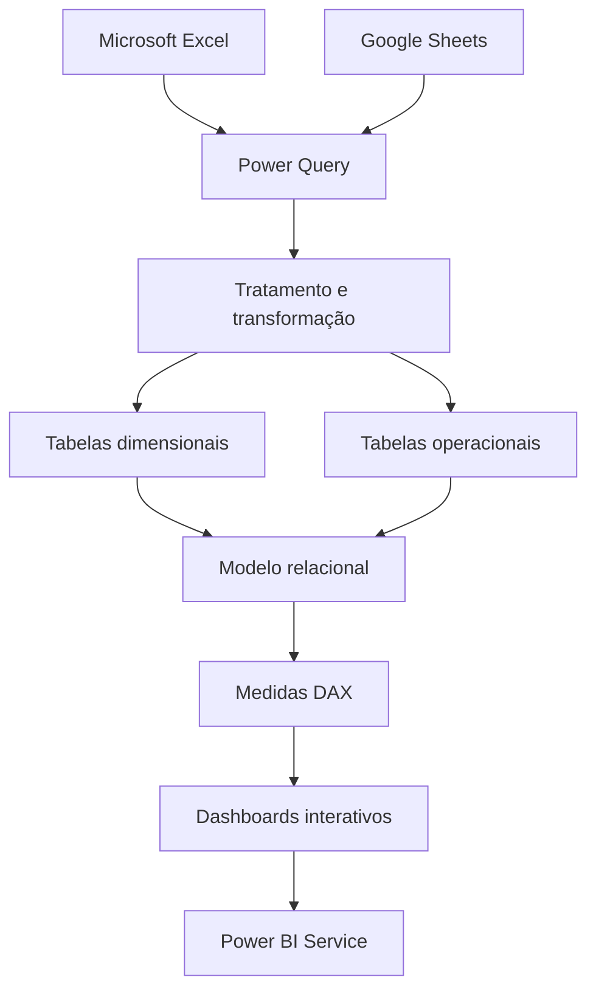

# Modelagem e Arquitetura de Dados — BI de Gestão de Análises e Liberações

## 1. Contextualização do projeto

O BI de Gestão de Análises e Liberações foi desenvolvido com o objetivo de integrar informações provenientes de diferentes processos laboratoriais e operacionais, possibilitando o acompanhamento de resultados analíticos, conformidades, não conformidades e liberações de produtos.

O principal desafio da modelagem consistiu na integração de múltiplas bases de dados com estruturas, nomenclaturas, identificadores e critérios de classificação distintos.

## 2. Arquitetura do modelo

A arquitetura apresenta características de um esquema constelação de fatos (Fact Constellation Schema), também conhecido como esquema galáxia.

O modelo é composto por múltiplas tabelas operacionais relacionadas a dimensões compartilhadas e específicas, permitindo a integração das informações sem comprometer as particularidades de cada processo.

A escolha dessa estrutura está associada à heterogeneidade das fontes de dados e à impossibilidade, na estrutura atual das bases, de utilizar um único identificador comum para todos os processos.

## 3. Tabelas operacionais

As tabelas operacionais foram organizadas conforme as características dos processos monitorados:

- Análises por mercado de destino.
- Análises por requisitos específicos.
- Monitoramento de ciclos analíticos.
- Análises liberativas.
- Controle de status de produtos.
- Consolidação de não conformidades.

A separação das tabelas permite preservar as particularidades estruturais e as regras de negócio de cada processo.

## 4. Tabelas dimensionais

O modelo utiliza dimensões compartilhadas e dimensões específicas.

| Dimensão | Finalidade |
|---|---|
| Calendário | Integração temporal e padronização dos filtros de datas |
| Produtos | Identificação e classificação dos produtos |
| Análises | Identificação dos tipos de análises |
| Dimensão de análises | Organização dos códigos analíticos |
| Cadastros específicos de produtos | Identificação de produtos em bases com estruturas distintas |
| Status geral | Classificação compartilhada dos resultados analíticos |
| Status específicos | Classificação conforme as particularidades de cada processo |

## 5. Estrutura dos relacionamentos

Os relacionamentos foram estabelecidos considerando a compatibilidade entre os atributos disponíveis nas tabelas operacionais e dimensionais.

### Características técnicas

- Cardinalidade de um para muitos (1:N).
- Direção de filtragem unidirecional.
- Propagação dos filtros das dimensões para as tabelas operacionais.
- Predominância de relacionamentos ativos.
- Compartilhamento de dimensões entre diferentes processos.
- Utilização de dimensões específicas conforme a necessidade de cada base.
- Existência de relacionamento experimental mantido como inativo.

### Chaves de relacionamento

Os atributos utilizados para estabelecer os relacionamentos incluem:

- Código do produto.
- Descrição do produto.
- Data de produção.
- Data de coleta.
- Código da análise.
- Resultado analítico.
- Status.
- Destinação.

A definição das chaves foi realizada individualmente, considerando a estrutura e os identificadores disponíveis em cada fonte de dados.

## 6. Mapeamento dos relacionamentos

A tabela abaixo apresenta uma representação generalizada dos relacionamentos existentes no modelo.

| Tabela operacional | Dimensões relacionadas |
|---|---|
| Mercado A | Produtos e Calendário |
| Mercado B | Produtos e Calendário |
| Mercado C | Produtos, Calendário e Status específico |
| Mercado D | Produtos, Calendário e Status específico |
| Mercado E | Produtos, Calendário e Status específico |
| Processo com requisitos específicos | Produtos, Calendário e Status específico |
| Monitoramento de ciclos | Calendário e Status específico |
| Análises liberativas A | Calendário e Status geral |
| Análises liberativas B | Análises, Dimensão de análises, Calendário, Produtos específicos e dimensões de status |
| Controle de status | Calendário e Status específico |
| Resumo de não conformidades | Produtos |
| Análises de requisitos específicos | Análises, Dimensão de análises, Calendário, Produtos específicos e Status geral |
| Consolidação de análises liberativas | Análises e Calendário |

Os relacionamentos permitem realizar análises segmentadas conforme as dimensões disponíveis para cada processo.

## 7. Dimensão calendário

A dimensão calendário constitui um dos principais elementos de integração do modelo.

Sua utilização permite estabelecer uma referência temporal compartilhada entre diferentes tabelas operacionais, respeitando o contexto de data utilizado em cada processo.

Entre suas aplicações estão:

- Segmentação temporal.
- Acompanhamento histórico.
- Comparação entre períodos.
- Análise de tendências.
- Padronização dos filtros de datas.
- Desenvolvimento de indicadores temporais.

## 8. Decisões técnicas da modelagem

### 8.1. Heterogeneidade das fontes de dados

As fontes de dados apresentam diferenças significativas em suas estruturas, nomenclaturas e critérios de identificação.

Essas diferenças dificultam a utilização de uma única dimensão de produtos com um identificador compartilhado entre todas as tabelas operacionais.

Diante dessa limitação, foram utilizados cadastros dimensionais específicos, permitindo estabelecer relacionamentos compatíveis com os atributos disponíveis em cada base.

Essa abordagem possibilitou a integração das informações sem exigir a reestruturação integral das fontes de dados.

### 8.2. Redundância dimensional

O modelo apresenta duas dimensões relacionadas à identificação das análises, denominadas Análises e Dimensão de Análises.

Essas tabelas possuem funções redundantes e foram mantidas na estrutura atual do modelo.

A redundância constitui uma limitação conhecida e uma oportunidade de otimização futura.

Uma eventual consolidação deverá considerar as dependências existentes, os relacionamentos estabelecidos e os possíveis impactos sobre medidas, filtros e visualizações.

### 8.3. Relacionamentos experimentais

Durante o desenvolvimento do modelo, foram realizados testes de relacionamento entre diferentes cadastros de produtos.

Um relacionamento experimental foi mantido como inativo.

Sua existência está associada aos testes realizados durante a construção da arquitetura, não participando da propagação padrão dos filtros.

A manutenção desse relacionamento não representa uma dependência funcional confirmada dos indicadores atuais.

### 8.4. Dimensões específicas de status

Foram utilizadas diferentes dimensões de status para atender às particularidades dos processos analíticos e operacionais.

Essa abordagem permite preservar critérios de classificação distintos, evitando a imposição de uma classificação única sobre processos com regras de negócio diferentes.

## 9. Fluxo de processamento dos dados

O fluxo de processamento está organizado nas seguintes etapas:

1. Extração das informações das fontes de dados.
2. Tratamento e transformação através do Power Query.
3. Organização das tabelas operacionais e dimensionais.
4. Estabelecimento dos relacionamentos.
5. Desenvolvimento de medidas e indicadores utilizando DAX.
6. Construção dos dashboards interativos.
7. Publicação e acompanhamento através do Power BI Service.

## 10. Representação conceitual da arquitetura

## 11. Benefícios da arquitetura

- Integração de diferentes processos analíticos.
- Preservação das particularidades das fontes de dados.
- Reutilização de dimensões compartilhadas.
- Padronização dos filtros temporais.
- Organização das regras de classificação.
- Análise segmentada por produto, período e processo.
- Centralização das informações para acompanhamento gerencial.
- Possibilidade de expansão do modelo mediante inclusão de novas fontes.

## 12. Limitações conhecidas

- Ausência de um identificador único compartilhado entre todas as bases.
- Heterogeneidade estrutural das fontes de dados.
- Necessidade de manutenção de cadastros dimensionais específicos.
- Existência de dimensões redundantes.
- Permanência de relacionamento experimental inativo.
- Dependência da consistência dos códigos, descrições e classificações presentes nas fontes.

## 13. Oportunidades de melhoria

Como possibilidades de evolução da arquitetura, destacam-se:

- Padronização dos identificadores nas fontes de dados.
- Avaliação da possibilidade de criação de um cadastro mestre de produtos.
- Avaliação da utilização de chaves substitutas.
- Consolidação das dimensões redundantes.
- Revisão dos relacionamentos experimentais.
- Validação da integridade referencial.
- Identificação de registros sem correspondência nas dimensões.
- Monitoramento da consistência das classificações de status.
- Redução da complexidade estrutural do modelo.
- Automatização das validações das fontes de dados.
- Monitoramento preventivo de falhas de atualização.

Essas melhorias dependem da avaliação das estruturas originais, das regras de negócio e das dependências existentes no modelo.

## 14. Tecnologias utilizadas

| Tecnologia | Aplicação |
|---|---|
| Microsoft Power BI Desktop | Desenvolvimento e modelagem |
| Power BI Service | Publicação e acompanhamento |
| Power Query | Extração, tratamento e transformação de dados |
| DAX | Desenvolvimento de medidas e indicadores |
| Microsoft Excel | Fonte de dados |
| Google Sheets | Armazenamento e fornecimento de informações |

## 15. Competências técnicas aplicadas

- Modelagem relacional de dados.
- Modelagem dimensional.
- Integração de múltiplas fontes.
- Processos de ETL.
- Definição de cardinalidades.
- Configuração de propagação de filtros.
- Desenvolvimento de indicadores.
- Interpretação de regras de negócio.
- Análise de processos industriais.
- Gestão de informações laboratoriais.
- Identificação de limitações estruturais.
- Avaliação de oportunidades de melhoria.

## 16. Confidencialidade

Esta documentação possui finalidade exclusivamente profissional e demonstrativa.

A arquitetura apresentada representa conceitualmente a solução desenvolvida, utilizando nomenclaturas generalizadas para preservar informações corporativas.

As bases de dados disponibilizadas para demonstração serão fictícias, sem exposição de informações operacionais, comerciais ou industriais confidenciais.

---

**Autora:** Anne Caroline Marquez Bragante

**Área:** Business Intelligence, Data Analytics e Gestão da Qualidade
